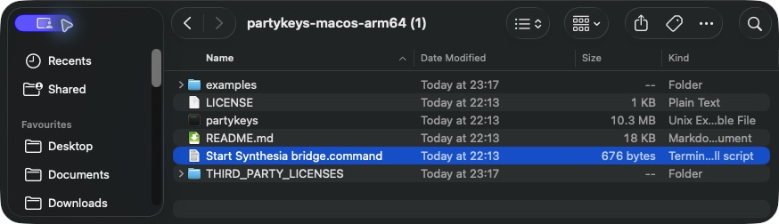

# Synthesia → PartyKeys bridge

Light PartyKeys keyboards, including multiple boards joined together, from Synthesia on macOS or Windows using a virtual MIDI cable. Requested notes and physically held keys light blue; keys return to dark when neither is active, including notes you miss.

## Download and start

[](https://github.com/teaqu/synthesia-partykeys-bridge/releases/latest/download/partykeys-macos-arm64.zip)
[](https://github.com/teaqu/synthesia-partykeys-bridge/releases/latest/download/partykeys-macos-x64.zip)
[](https://github.com/teaqu/synthesia-partykeys-bridge/releases/latest/download/partykeys-windows-x64.zip)

**Download the ZIP, extract it, then double-click the “Start Synthesia bridge” launcher. No Python installation needed.**

| Your computer | Direct download | Setup guide |
| --- | --- | --- |
| Mac with Apple Silicon (M1 or newer), macOS 14+ | [Download for Apple Silicon](https://github.com/teaqu/synthesia-partykeys-bridge/releases/latest/download/partykeys-macos-arm64.zip) | [Mac setup](#set-up-synthesia-on-macos) |
| Mac with an Intel processor, macOS 15+ | [Download for Intel Mac](https://github.com/teaqu/synthesia-partykeys-bridge/releases/latest/download/partykeys-macos-x64.zip) | [Mac setup](#set-up-synthesia-on-macos) |
| 64-bit Windows PC | [Download for Windows](https://github.com/teaqu/synthesia-partykeys-bridge/releases/latest/download/partykeys-windows-x64.zip) | [Windows setup](#set-up-on-windows) |

Not sure which Mac download to choose? Open **Apple menu → About This Mac**: “Chip: Apple M…” means Apple Silicon; “Processor: Intel…” means Intel.

[Release notes and all downloads](https://github.com/teaqu/synthesia-partykeys-bridge/releases/latest) · [SHA-256 checksums](https://github.com/teaqu/synthesia-partykeys-bridge/releases/latest/download/SHA256SUMS.txt)

> **Requires PartyKeys keyboard firmware v9. Update your keyboard with PartyKeys Hub before using the bridge.**

## Requirements

- One or more PartyKeys 36 boards with **firmware v9**.
- macOS or 64-bit Windows, Synthesia, and a USB data connection to the keyboard.
- Python 3.10 or newer for source installs. The executable downloads include Python.
- A virtual MIDI connection: created automatically by the Mac launcher, or a tool such as loopMIDI on Windows.

Use [PartyKeys Hub](https://apps.apple.com/app/id6797699163) to update your keyboard. The update requires the keyboard to connect to Wi-Fi. Check the **keyboard firmware version**, which is separate from the Hub app version.

Only **macOS has been tested with a physical keyboard so far**. Windows builds are available, but keyboard operation on Windows has not yet been tested.

This is an independent community project, not an official Synthesia or PartyKeys integration.

## Opening your download

Extract the ZIP before running it. Each download includes a command-line executable, a launcher, this guide, a demo MIDI file, and license notices. The Mac downloads are not notarized; if macOS blocks the launcher or executable, review it in **System Settings → Privacy & Security** and use **Open Anyway** if you trust the download. The Windows executable is unsigned.

## Set up on Windows

1. Install [loopMIDI](https://www.tobias-erichsen.de/software/loopmidi.html), create a port named **Synthesia Lights**, and leave loopMIDI running.
2. In Synthesia, use **PartyKeys** for music input. Set **Synthesia Lights** as a music output with **Key Lights → Finger-based channel**. Disable ordinary notes/background/percussion/metronome on that output; keep Synthesia's built-in audio enabled. Disable direct music output to PartyKeys.
3. Double-click **Start Synthesia bridge.cmd**, then start a song in Synthesia. Press Ctrl+C in the console to stop.

The launcher uses cue-only lighting (`--no-press-feedback`), so Synthesia owns the physical MIDI input. Windows MIDI drivers can restrict simultaneous access to the same hardware input. The bridge still lights requested notes and clears missed cues. If your driver supports shared input, omit `--no-press-feedback` to enable physical held-key feedback too.

For custom port names, open PowerShell in the extracted folder:

```powershell
.\partykeys.exe ports
.\partykeys.exe bridge --input "Synthesia Lights" --output "YOUR PARTYKEYS OUTPUT" --no-press-feedback --palette-interval-ms 10
```

Always specify `--input` on Windows; automatic cue discovery currently looks for macOS IAC. Windows has no built-in IAC bus, and the executable does not install a virtual MIDI driver.

## Set up Synthesia on macOS

1. Double-click **Start Synthesia bridge.command** in the extracted Mac download. It creates a MIDI destination named **Synthesia Lights** automatically. Leave the terminal open.

   

2. Open **Synthesia → Settings → Music Devices**. Enable **PartyKeys** under **Music Input** and disable **PartyKeys** under **Music Output**. Keep **Built-in MIDI Synthesizer** enabled for sound, then select **Synthesia Lights** under **Music Output**.

   

   The screenshot shows the completed setup. Any **IAC Driver** entries are from an older manual setup; you do not need to create them.

3. Enable **Send output to this device**. Turn off **My Notes**, **Background Instruments**, **Percussion**, and **Metronome** on **Synthesia Lights**.

   

4. Open **Key Lights**, scroll down, and select **Finger-based channel**.

   

5. Close any other apps controlling PartyKeys LEDs, then start a song.

There is no Audio MIDI Setup/IAC configuration or extra driver to install with this method. The MIDI destination exists while the bridge runs and disappears when it exits. Start the bridge before choosing the output in Synthesia. Synthesia's output selection is still a one-time manual step; the launcher does not edit Synthesia's settings. If another bridge already owns that destination, the new instance stops rather than creating a duplicate.

For custom settings, open Terminal in the extracted folder and run:

```sh
./partykeys bridge \
  --virtual-input --input "Synthesia Lights" \
  --output "PartyKeys" \
  --pressed-input "PartyKeys" \
  --palette-interval-ms 10
```

Start a song in Synthesia. Press **Ctrl+C** in the terminal to clear the lights and exit.

Port names can be exact names or unambiguous substrings. Use `./partykeys ports` to see your names. Once selected, automatic reconnection stays restricted to those exact names.

With `--virtual-input`, `--input` is the exact name to create, defaulting to **Synthesia Lights**. This option is macOS-only. Existing IAC setups still work: omit `--virtual-input` and use `--input "IAC Driver Synthesia Lights"`. To set up IAC manually, open **Audio MIDI Setup → Window → Show MIDI Studio → IAC Driver**, enable **Device is online**, and add a **Synthesia Lights** bus.

For source installs, use `partykeys` instead of `./partykeys`. Elsewhere in this guide, replace `partykeys` with `./partykeys` for the Mac executable or `.\partykeys.exe` in Windows PowerShell.

## Lighting behavior and speed

- Synthesia cues and physically held keys are **blue** by default.
- A missed cue goes dark when Synthesia sends its release. A key still physically held stays blue until released.
- Physical input is used only for LED feedback; the bridge does not duplicate the notes Synthesia receives.
- Releases clear obsolete lights before new cues are illuminated. Pending updates use the latest state, so old chords do not build up in a queue.
- Live lighting follows Synthesia's key-light messages. The bridge uses one cue color and does not add advance timing to Synthesia. Timed advance lighting is available only in the independent MIDI-file preview below.

Palette mode (`palette71`, the bridge default) sends up to **three note/color pairs per packet**, at most 16 bytes. It enters lighting mode once, uses explicit per-note off messages, and never sends the global `71 00` all-off command.

| `--palette-interval-ms` | Maximum packet rate | Use |
| --- | --- | --- |
| `10` | 100/second | Recommended for responsive lighting |
| `20` | 50/second | Slower alternative |
| `40` | 25/second | Slower alternative |
| `100` | 10/second | Diagnostic option |
| `250` | 4/second | Conservative CLI default |

These are minimum send intervals, not measured end-to-end LED latency. Every write, including forced updates and cleanup, is paced. A three-note chord fits in one packet; larger changes take multiple packets. The main loop polls every 10 ms.

The CLI keeps a conservative 250 ms default. **Pass `--palette-interval-ms 10` for the fast setup above.** Firmware v9 is required at every speed.

Palette colors have fixed device brightness; `--brightness` does not dim them. The optional `--protocol rgb15` uses custom RGB colors, one key per 250 ms, and a full startup clear that takes about ten seconds. Use palette mode for responsive Synthesia lighting.

### Options

```sh
# Change hand colors and make physically pressed keys red.
partykeys bridge --input "Synthesia Lights" --palette-interval-ms 10 \
  --left-color 0050FF --right-color FF6400 --pressed-color FF0000

# Follow Synthesia cues without physical-key feedback.
partykeys bridge --input "Synthesia Lights" --palette-interval-ms 10 --no-press-feedback

# Inspect incoming MIDI and routing.
partykeys bridge --input "Synthesia Lights" --debug
```

For joined boards, use explicit destinations to prevent the same cue appearing on multiple boards. Repeat `--board CHANNEL:ADDRESS:LOWEST_NOTE` for each 36-key board, with its lowest note **at octave zero**. For example, a pair using routing channel 1, addresses `0x3f` and `0x40`, and lowest notes 48 and 84:

```sh
partykeys bridge --virtual-input --input "Synthesia Lights" \
  --output "PartyKeys Bluetooth" --pressed-input "PartyKeys Bluetooth" \
  --palette-interval-ms 10 --board 1:0x3f:48 --board 1:0x40:84
```

Use your device's actual port names, routing channel, addresses, and note ranges. The routing channel is the PartyKeys protocol value, not Synthesia's finger channel. This option routes lighting only; it does not assign device addresses, change the keyboard's octave, or transpose music.

**Octave buttons work automatically while the bridge is running.** The bridge reads the keyboard's octave reports, shifts all configured boards on that routing channel, clears stale held-key feedback, and redraws the current song cues. Keep the physical input enabled for this (`--pressed-input`); `--no-press-feedback` closes that input and therefore disables automatic octave detection too.

If the keyboard is already shifted before starting the bridge, pass its current setting with `--initial-octave -1` (one octave down, for example). Keep the `--board` lowest notes at their octave-zero values. Later button presses override this starting value automatically; the bridge also preserves the latest reported octave when reconnecting its output. Octave changes made while the physical input is disconnected cannot be observed until the keyboard sends another report.

Notes outside the physical ranges stay unlit. Without `--board`, palette mode broadcasts MIDI 0–127, which can mirror lights on joined boards. The optional RGB driver supports a single 36-key board: `--base-note` sets its leftmost note (default 48); `--board` requires palette mode.

Finger-channel defaults use 1-based MIDI channels: left **2–6, 12**; right **1, 7–11, 13**. Override these with `--left-channels` and `--right-channels`. A channel-1 release clears that pitch across all cue channels to handle Synthesia’s shared release channel. Physical held-key state remains separate. Note On with velocity zero is a release; CC16 on channel 1, CC120/123, and MIDI Stop/Reset clear applicable cue state.

## Independent MIDI preview

`preview` reads a MIDI file and supplies its own timing and advance lighting. **It is not synchronized with Synthesia.**

```sh
partykeys inspect examples/demo.mid
partykeys preview examples/demo.mid --lookahead 2 --near 1 --brightness 0.6
```

The default preview uses the slower RGB driver: dim hand color for an approaching note, bright hand color nearer its onset, green while active, then dark. For the faster palette driver:

```sh
partykeys preview examples/demo.mid --protocol palette71 --palette-interval-ms 10
```

Palette mode cannot reproduce continuous brightness dimming. Preview commands, entered in its terminal, are `pause`, `resume`, `seek 35.5`, `speed 0.75`, `stop`, `play`, `status`, and `quit`. Lookahead is measured in real seconds at the selected speed; seek positions use song seconds. Pause clears lights; stop returns to pre-roll.

Use `--left-tracks` / `--right-tracks` for zero-based track indices, or `--left-channels` / `--right-channels` for 1-based MIDI channels. Track assignments take precedence. `--latency-ms` advances LED changes only and does not synchronize with another application.

Optional `--audio-output "YOUR SYNTH MIDI INPUT"` plays file notes through a separate MIDI synthesizer. Use a dedicated audio destination: pause, seek, and exit send panic/reset there. File SysEx is not forwarded. Sustained tails and synthesizer envelopes cannot be reconstructed exactly after seeking.

Type 0/1 PPQN MIDI files and tempo changes are supported. Type 2 and SMPTE timing are rejected. Lights follow note durations rather than sustain-pedal tails.

## Troubleshooting

- **Resets or a multicoloured startup pattern:** stop sending LED commands and confirm keyboard firmware v9. Check the USB cable, power, and other LED-controlling apps. Try a larger `--palette-interval-ms` value, such as `20` or `40`, to slow LED updates while diagnosing. The bridge's automatic reconnection cannot fix a device firmware or power fault.
- **Missing or mirrored lights on joined boards:** configure one `--board` destination per board as above, using octave-zero lowest notes. Keep the keyboard input enabled to follow octave buttons automatically; use `--initial-octave` if already shifted at startup. A song note outside your physical range has no key to light. Versions through v0.1.3 broadcast to all boards and do not support explicit destinations.
- **No cues:** keep the Mac bridge running so its **Synthesia Lights** output is available, or check your manual IAC/Windows loopMIDI port. Check Synthesia's Key Lights setting and keep ordinary music output off the lighting bus. `--debug` shows received messages.
- **Delayed lights:** include `--palette-interval-ms 10`; the default is 250 ms. Synthesia controls when cues arrive.
- **Disconnected device:** bridge mode retries missing ports and MIDI errors once per second, then initializes and applies current state. Preview mode stops on disconnection. Already-held physical keys cannot be reconstructed; release and press again.
- **Shutdown:** cleanup is paced and may take several seconds. A second interrupt aborts remaining cleanup. An unplugged device or killed process cannot be cleared. The previous built-in LED animation is not restored.

## Install from source on macOS

```sh
git clone https://github.com/teaqu/synthesia-partykeys-bridge.git
cd synthesia-partykeys-bridge
python3 -m venv .venv
source .venv/bin/activate
python -m pip install -e .
partykeys ports
```

Dependencies are `mido` and `python-rtmidi`. If no suitable RtMidi wheel is available, installation may require macOS Command Line Tools.

## Development

The [Executables workflow](https://github.com/teaqu/synthesia-partykeys-bridge/actions/workflows/executables.yml) builds Windows x64, macOS Apple Silicon, and macOS Intel downloads on native runners. Each build runs the test suite and checks the packaged executable: help, MIDI port enumeration, MIDI-file inspection, dry-run lighting, and preview controls. Every push to `main`, pull request, or manual workflow run produces ZIPs and SHA-256 checksums. Releases provide stable downloads of selected builds.

```sh
python -m unittest discover -s tests -v
partykeys test --dry-run --note 60 --seconds 0.1
partykeys preview examples/demo.mid --dry-run --lookahead 0.2 --speed 2
```

`--dry-run` sends no hardware LED output. Preview/test dry runs require no MIDI hardware; bridge dry runs still read a cue input and create the temporary destination when `--virtual-input` is used.

Optional macOS integration check:

```sh
python tests/coremidi_smoke.py
python tests/mac_virtual_input_smoke.py
```

It opens only temporary virtual MIDI ports, verifies routing and cleanup, and has a 30-second watchdog. It does not send to the physical keyboard.

The automatic-setup check tests destination creation, note-on/off routing, refresh, and destination removal without opening hardware ports. Mac executable builds also run it against the packaged binary.

The driver handles RGB/palette framing and state; the bridge interprets cue/physical MIDI; connection management handles discovery and recovery; the song and preview modules handle independent playback. Input uses direct RtMidi polling.

## License

This project is licensed under the [MIT License](LICENSE). Bundled dependencies retain their own licenses, included in `THIRD_PARTY_LICENSES` in each executable download.

## References and acknowledgments

- [luoshichuan-ai's PartyKeys MIDI Light Bridge](https://github.com/luoshichuan-ai/PartyKeys-midi-keyboard-light-bridge): the palette approach, mode-entry-only connection, explicit note-off, and avoidance of global all-off informed this implementation. That project serves browser piano apps; this bridge connects desktop Synthesia through IAC.
- [PartyKeys RGB protocol reference](https://github.com/allen4z/PartykeysProtocol/blob/main/LED_PROTOCOL.md) and [PartyKeys protocol documentation](https://protocol.partykeys.org/): SysEx framing, RGB encoding, and key layout. Device and speaker-relay profiles differ; this implementation targets the directly connected keyboard.
- [SynthesiaKontrol](https://github.com/ojacques/SynthesiaKontrol) and [key_led](https://github.com/touchgadget/key_led): Synthesia key-light channel and release interpretation.
- [Apple IAC setup](https://support.apple.com/guide/audio-midi-setup/transfer-midi-information-between-apps-ams1013/mac) and [Mido RtMidi backend](https://mido.readthedocs.io/en/stable/backends/rtmidi.html).
