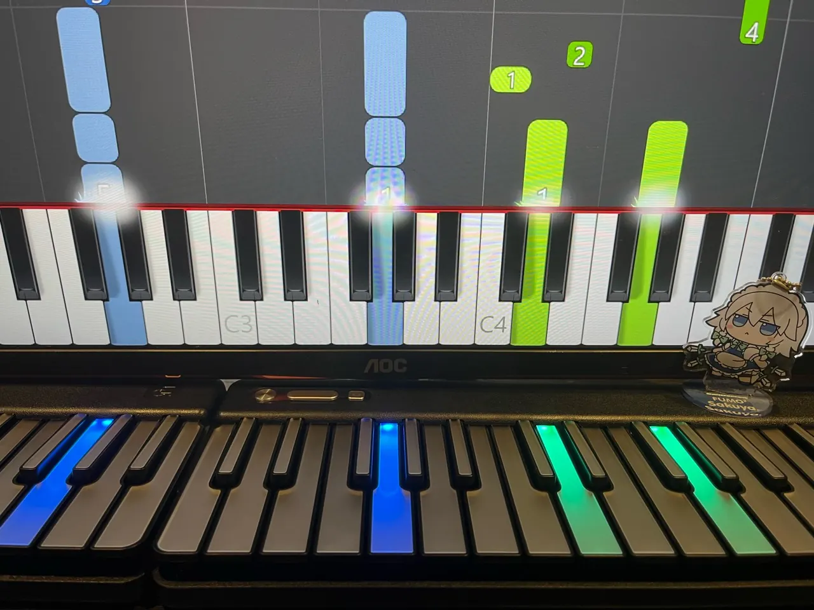
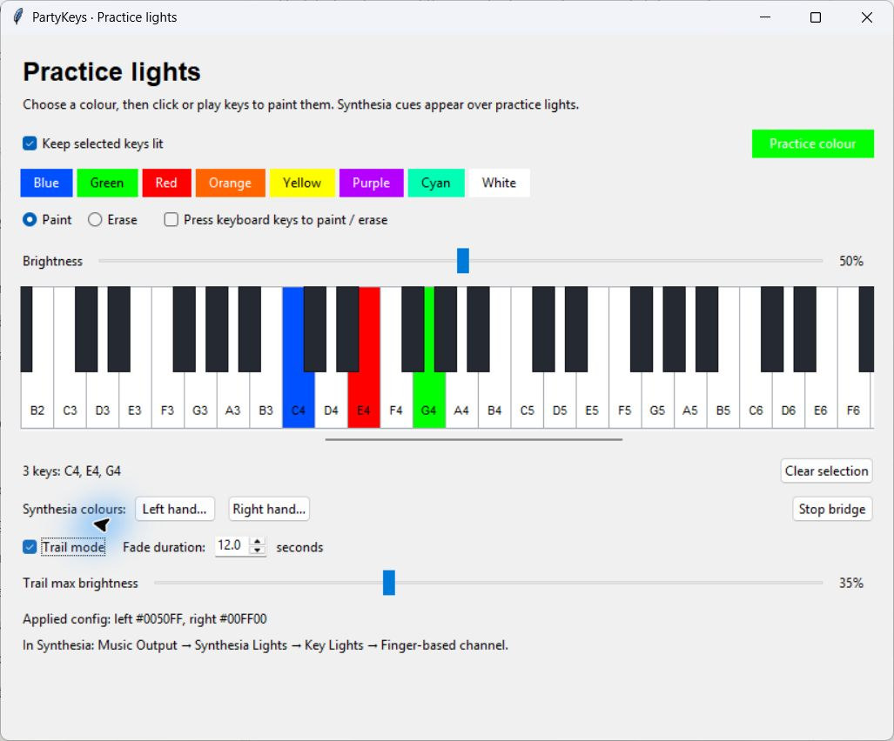
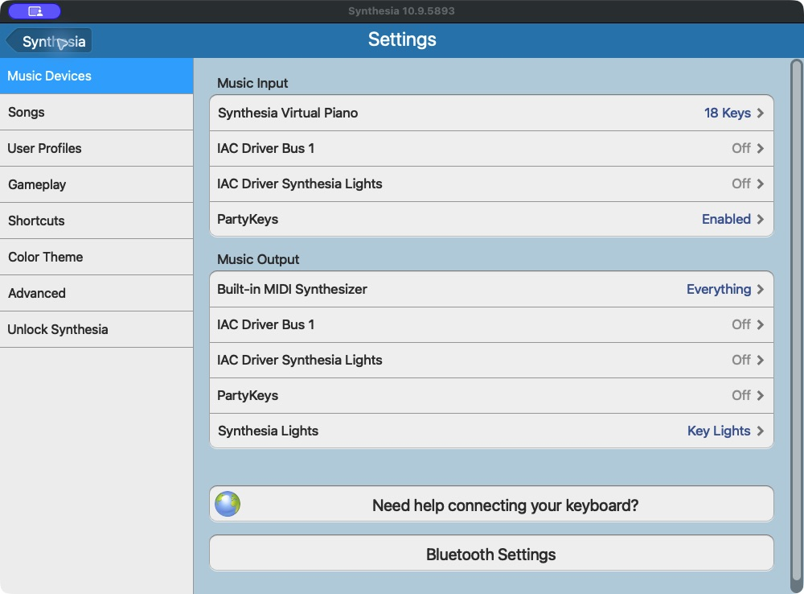
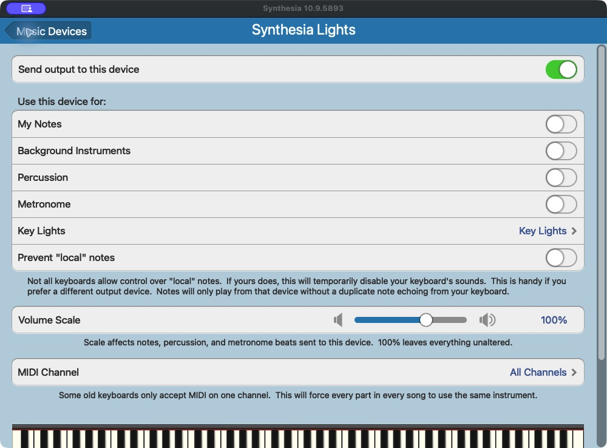
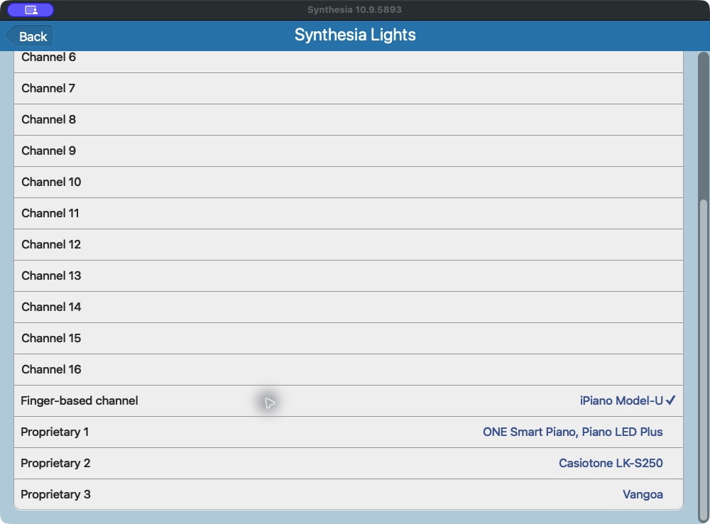
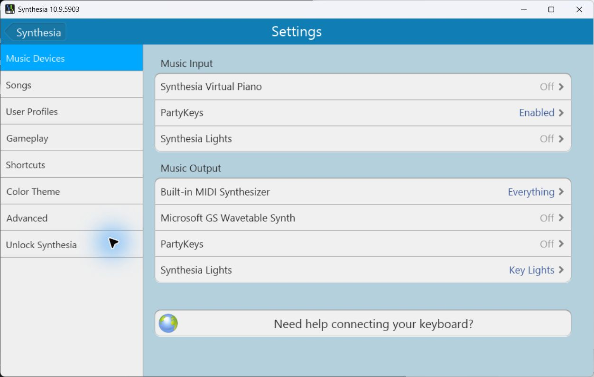
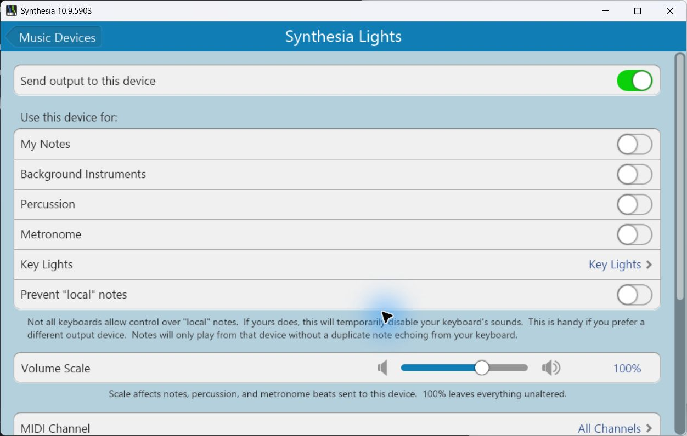
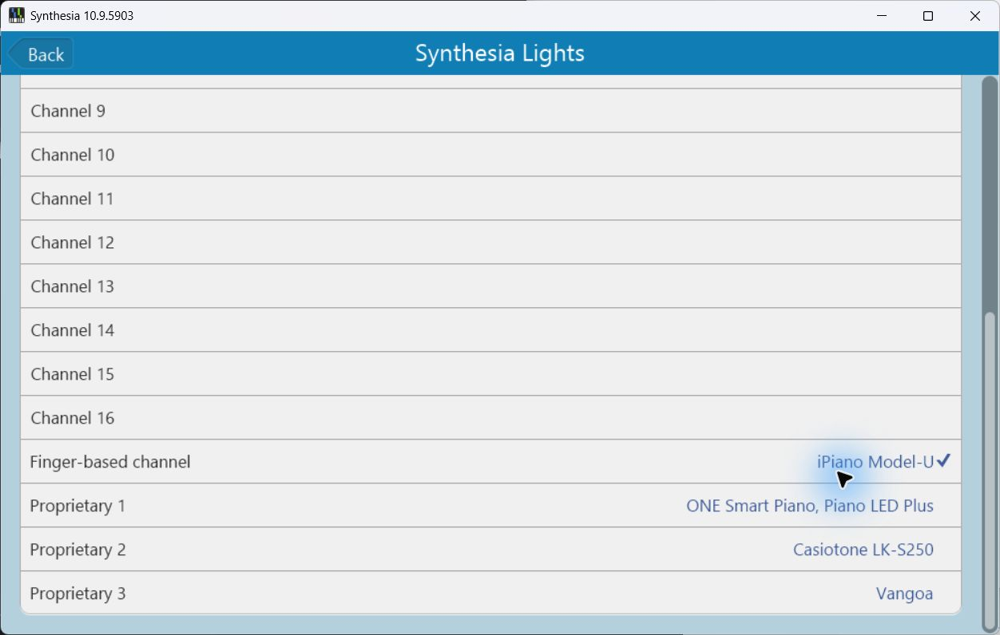
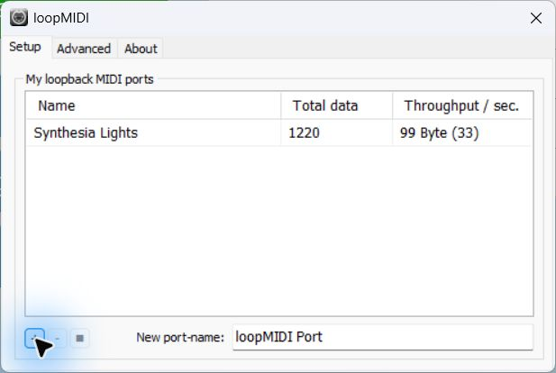

# Synthesia → PartyKeys bridge



Light your PartyKeys keyboard from Synthesia, choose practice colours for individual keys, and add fading trails. Open the desktop app on Windows or macOS to control the lights. Practice colours work on their own, and Synthesia cues take priority during a song. Joined PartyKeys boards are supported.

## Get started

1. **Download and extract the ZIP for your computer:** [Windows](https://github.com/teaqu/synthesia-partykeys-bridge/releases/download/v0.1.7/partykeys-lights-v0.1.7-windows-x64.zip), [Mac with Apple Silicon](https://github.com/teaqu/synthesia-partykeys-bridge/releases/download/v0.1.7/partykeys-lights-v0.1.7-macos-arm64.zip), or [Intel Mac](https://github.com/teaqu/synthesia-partykeys-bridge/releases/download/v0.1.7/partykeys-lights-v0.1.7-macos-x64.zip).
2. Connect your PartyKeys keyboard by USB. Stop any older bridge instance before opening the GUI.
3. Open the launcher for your platform:

   | Platform | Open this file |
   | --- | --- |
   | Windows | **Practice lights.cmd** |
   | macOS, Apple Silicon or Intel | **Practice lights.command** |

4. Keep the window open. For practice lights, choose a colour and **Paint** or **Erase**, then click keys. Right-click temporarily does the opposite. To edit by playing your physical keyboard, enable **Use physical keyboard to paint / erase**. For Synthesia, follow the [Mac setup](#set-up-synthesia-on-macos) or [Windows setup](#set-up-on-windows) once, then start a song.

**No Python installation is needed for packaged downloads.** The GUI starts the bridge itself; you do not need to run the console launcher alongside it. Close the window to stop its bridge and clear the lights.

The GUI gives you:

- Independent colours for each practice key, with eight presets and a custom colour picker.
- Physical keyboard painting and erasing, plus saved practice selections and brightness.
- Synthesia left- and right-hand colour controls.
- Trail mode with immediate fading, adjustable duration and a separate maximum brightness.
- Start/stop controls and live settings changes, with 1 ms LED pacing by default.

The console launcher remains available for terminal use.

## Downloads

[](https://github.com/teaqu/synthesia-partykeys-bridge/releases/download/v0.1.7/partykeys-lights-v0.1.7-macos-arm64.zip)
[](https://github.com/teaqu/synthesia-partykeys-bridge/releases/download/v0.1.7/partykeys-lights-v0.1.7-macos-x64.zip)
[](https://github.com/teaqu/synthesia-partykeys-bridge/releases/download/v0.1.7/partykeys-lights-v0.1.7-windows-x64.zip)

Each download includes the desktop app, **Practice lights** launcher, console launcher, setup guide and license notices. No GitHub sign-in is needed.

| Your computer | Direct download | Setup guide |
| --- | --- | --- |
| Mac with Apple Silicon (M1 or newer), macOS 14+ | [Download for Apple Silicon](https://github.com/teaqu/synthesia-partykeys-bridge/releases/download/v0.1.7/partykeys-lights-v0.1.7-macos-arm64.zip) | [Mac setup](#set-up-synthesia-on-macos) |
| Mac with an Intel processor, macOS 15+ | [Download for Intel Mac](https://github.com/teaqu/synthesia-partykeys-bridge/releases/download/v0.1.7/partykeys-lights-v0.1.7-macos-x64.zip) | [Mac setup](#set-up-synthesia-on-macos) |
| 64-bit Windows PC | [Download for Windows](https://github.com/teaqu/synthesia-partykeys-bridge/releases/download/v0.1.7/partykeys-lights-v0.1.7-windows-x64.zip) | [Windows setup](#set-up-on-windows) |

Not sure which Mac download to choose? Open **Apple menu → About This Mac**: “Chip: Apple M…” means Apple Silicon; “Processor: Intel…” means Intel.

[Release notes and all downloads](https://github.com/teaqu/synthesia-partykeys-bridge/releases/latest) · [SHA-256 checksums](https://github.com/teaqu/synthesia-partykeys-bridge/releases/download/v0.1.7/SHA256SUMS-v0.1.7.txt)

> **Requires PartyKeys keyboard firmware v9. Update your keyboard with PartyKeys Hub before using the bridge.**

## Using the GUI



Choose one of the eight preset colours or use **Practice colour** for a custom
colour, then choose **Paint** or **Erase**. Left-click follows the selected mode;
right-click temporarily does the opposite (Control-click works too on macOS).
The selected mode stays unchanged after right-clicking. Each key keeps its own
colour when you change the brush. **Practice brightness** applies to all practice keys.

**Bridge brightness** controls Synthesia's active key lights from 0–100% (100%
by default). Changes apply live, including to keys already lit, and are saved
for the next launch. Practice brightness and trail maximum brightness remain
independent. Below 100%, the bridge uses per-key RGB to dim the hardware's
otherwise fixed-brightness palette colours.
Turn off **Enable bridge lights** to hide Synthesia cues and their trails on the
physical keyboard. Practice lights and GUI pressed-key feedback keep working.
Re-enable it to restore the current cues. This setting is also saved.
Enable **Use physical keyboard to paint / erase** to apply the selected mode
by playing your physical keyboard; turn this off for normal
practice. Releasing a key does not erase its saved practice colour.

Hold the mouse button and drag across keys to paint or erase multiple keys in
one stroke. Left-drag follows the selected mode; right-drag (or Mac Control-drag)
does the opposite. Release the button to finish the stroke.

Selected keys retain their saved colour. Physically held
keys look pushed down, with a darker face, inset shadow, and lowered label, even
when **Use physical keyboard to paint / erase** is off. This lets you identify
pitches without editing the selection. The view scrolls to reveal keys you play,
and keys return to their normal appearance and saved colour on release.
Clicking a key also pushes it down until you release the mouse button.

Enable **Trail mode** to fade Synthesia cues after note release, with a duration
from 0.25 to 30 seconds. **Trail max brightness** caps the released trail (35%
by default) independently of practice brightness and held cues. On release it
immediately drops to that cap and visibly fades during the first 120 ms, even
with a long duration; the remaining tail then fades to zero over the selected
duration. Held cues stay bright and repeated notes light fully
again. Saved practice colours remain underneath trails. Song stop/reset clears
trails immediately. RGB updates are paced by the keyboard protocol, so large
chords can fade in visible steps rather than smoothly.

Click white or black keys to select the exact pitches to keep lit. Scroll to other
octaves, choose **Practice colour**, and adjust **Practice brightness** (8% by default).
Uncheck **Enable practice lights** to disable the background without losing your
selection. **Clear selection** removes all selected notes. Changes save automatically
to `config.json`; GUI changes apply immediately while the bridge runs.
The `live_reload` setting controls edits made to the file outside the GUI.
Only pitches available on the connected boards light up; labels use C4 = MIDI 60.

Synthesia continues to use **Music Output → Synthesia Lights → Key Lights →
Finger-based channel**. Its hand cues override practice lights; releasing a cue
restores the faint colour. Resetting or stopping a song keeps your practice
selection. Closing the window stops its bridge, clears LEDs and releases ports.
The **Left hand…** and **Right hand…** buttons change Synthesia cue colours
(the fast palette protocol uses the closest supported hue).

## Requirements

- One or more PartyKeys 36 boards with **firmware v9**.
- macOS or 64-bit Windows and a USB data connection to the keyboard. Synthesia is only needed for song cues; standalone practice lighting works without it.
- A virtual MIDI connection: created automatically by the Mac launcher or the experimental Windows 11 25H2+ launcher. Older Windows configurations can use loopMIDI.

Use [PartyKeys Hub](https://apps.apple.com/app/id6797699163) to update your keyboard. The update requires the keyboard to connect to Wi-Fi. Check the **keyboard firmware version**, which is separate from the Hub app version.


This is an independent community project, not an official Synthesia or PartyKeys integration.

## Opening your download

Extract the ZIP before running it, then open **Practice lights**. Current builds include the app executable, both launchers, this guide, and license notices. The Mac downloads are not notarized; if macOS blocks the launcher or executable, review it in **System Settings → Privacy & Security** and use **Open Anyway** if you trust the download. The Windows executable is unsigned.

## Set up Synthesia on macOS

1. Double-click **Practice lights.command** in the extracted Mac GUI build and keep the window open. It starts the bridge and creates a MIDI destination named **Synthesia Lights** automatically. **Start Synthesia bridge.command** is the console-only alternative.

2. Open **Synthesia → Settings → Music Devices**. Enable **PartyKeys** under **Music Input** and disable **PartyKeys** under **Music Output**. Keep **Built-in MIDI Synthesizer** enabled for sound, then select **Synthesia Lights** under **Music Output**.

   

   The screenshot shows the completed setup. Any **IAC Driver** entries are from an older manual setup; you do not need to create them.

3. Enable **Send output to this device**. Turn off **My Notes**, **Background Instruments**, **Percussion**, and **Metronome** on **Synthesia Lights**.

   

4. Open **Key Lights**, scroll down, and select **Finger-based channel**.

   

5. Close any other apps controlling PartyKeys LEDs, then start a song.

There is no Audio MIDI Setup/IAC configuration or extra driver to install with this method. The MIDI destination exists while the bridge runs and disappears when it exits. Start the bridge before choosing the output in Synthesia. Synthesia's output selection is still a one-time manual step; the launcher does not edit Synthesia's settings. If another bridge already owns that destination, the new instance stops rather than creating a duplicate.


Close the app window when you finish to clear the lights and stop the bridge.

## Set up on Windows

On **Windows 11 25H2 or newer**, the app creates the Synthesia connection automatically. For older Windows versions, use the [loopMIDI setup below](#using-loopmidi-instead).

1. Extract the **entire app ZIP**, keeping `native-midi-helper` beside `partykeys.exe`. Double-click **Practice lights.cmd** and keep the window open. **Start Synthesia bridge.cmd** is the console-only alternative.
2. Open Synthesia → Settings → Music Devices. Use **PartyKeys** for Music Input and disable PartyKeys under Music Output. Keep the built-in synthesizer enabled for sound.
3. Select **Synthesia Lights** under Music Output and enable sending to it. Disable My Notes, Background Instruments, Percussion, and Metronome on that output. Select **Key Lights → Finger-based channel**.
4. Start a song. Close the GUI window to clear the lights and remove its temporary MIDI ports. For the console alternative, press Ctrl+C in its terminal.

**Music Devices:** enable PartyKeys as input, keep the built-in synthesizer for sound, and use Synthesia Lights only for key lights.



**Synthesia Lights output:** turn sending on and leave My Notes, Background Instruments, Percussion, and Metronome off.



**Key Lights:** scroll down and select Finger-based channel. The check mark shows the selected mode.




Start the app before Synthesia. If cues do not return after restarting the app, restart Synthesia and select **Synthesia Lights** again. Keep only one bridge instance open.

### Using loopMIDI instead

For older Windows versions, or when using loopMIDI instead of the native MIDI API:

1. Install and open [loopMIDI](https://www.tobias-erichsen.de/software/loopmidi.html).
2. On **Setup**, enter **Synthesia Lights** in **New port-name**, then click **+** at the bottom left. The new port appears in the list, as shown below.
3. Leave loopMIDI running, then open **Practice lights.cmd** (or **Start Synthesia bridge.cmd** for console use). Keep `midi.input` in `config.json` set to `Synthesia Lights`; the bridge reuses that port without starting its native MIDI helper. You can also set `midi.create_virtual_input` to `false` to explicitly use the existing port.
4. In Synthesia, select **Synthesia Lights** under **Music Output**, enable sending, leave ordinary notes off, and choose **Key Lights → Finger-based channel**, as shown in the Windows screenshots above. Keep **PartyKeys** as Music Input and its Music Output off.



The screenshot shows the port after clicking **+**, with MIDI traffic passing through it. **Total data** increases as messages arrive; **Throughput / sec.** can return to `0 Byte` between messages. Open loopMIDI before the bridge and Synthesia on later runs too. Use either loopMIDI or the native bridge for this name; stop the native bridge before creating the loopMIDI port to avoid duplicate names.

## Troubleshooting

- **Shifted lights, missing low notes, or playing the right keyboard paints the left:** the app may have started after the keyboard was already octave-shifted. Keep the bridge running and use the physical octave buttons to select the desired octave; each press reports the resulting octave and resyncs both Synthesia and practice-light routing. To return to the same octave, move one step away from the current setting and back (choose a direction that is not already at its limit). Starting the bridge assumes octave zero until it receives an octave report.
- **A joined keyboard is still missing after octave resync:** stop the app and unplug the MIDI/USB cable. Detach and reattach the joined keyboard, reconnect USB, then restart the app. If the octave is already shifted, resync it using the octave buttons while the bridge runs.
- **No practice lights:** turn on **Enable practice lights**, paint some keys, and raise **Practice brightness**. Choose pitches available on your connected keyboard.
- **Playing keys does not assign colours:** enable **Use physical keyboard to paint / erase** and choose **Paint**. Turn it off again for normal practice.
- **No Synthesia cues:** keep the app running, enable **Synthesia Lights** in Synthesia's Music Output, and select **Key Lights → Finger-based channel**. Restart Synthesia if the output disappeared while restarting the app.
- **Missing lights on joined boards:** check the connections and octave settings, then reconnect the keyboard. Notes outside the connected boards' range cannot light up.
- **Resets or a multicoloured startup pattern:** confirm PartyKeys firmware v9, check USB power and the cable, and close other apps controlling the LEDs.
- **Disconnected keyboard:** leave the app open; it reconnects when the keyboard returns.
- **Finish playing:** close the app window to stop the bridge and clear its lights.

## Development

The [Executables workflow](https://github.com/teaqu/synthesia-partykeys-bridge/actions/workflows/executables.yml) builds Windows x64, macOS Apple Silicon, and macOS Intel downloads on native runners. Each build runs the test suite and checks the packaged executable: help, MIDI port enumeration, MIDI-file inspection, dry-run lighting, preview controls, and a real Tk GUI launch. The GUI check runs on native Windows, Intel Mac and Apple Silicon runners, exercises painting/erasing and trail controls, saves settings in a temporary folder, and closes the window without opening MIDI ports. Every push to `main`, pull request, or manual workflow run produces ZIPs and SHA-256 checksums. Releases provide stable downloads of selected builds.

```sh
python -m unittest discover -s tests -v
python scripts/smoke_gui.py dist/partykeys  # Use dist/partykeys.exe on Windows
partykeys test --dry-run --note 60 --seconds 0.1
partykeys preview "YOUR SONG.mid" --dry-run --lookahead 0.2 --speed 2
```

`--dry-run` sends no hardware LED output. Preview/test dry runs require no MIDI hardware; bridge dry runs still read a cue input and create the temporary destination when `--virtual-input` is used.

Optional macOS integration check:

```sh
python tests/coremidi_smoke.py
python tests/mac_virtual_input_smoke.py
```

It opens only temporary virtual MIDI ports, verifies routing and cleanup, and has a 30-second watchdog. It does not send to the physical keyboard.

The automatic-setup check tests destination creation, note-on/off routing, refresh, and destination removal without opening hardware ports. Mac executable builds also run it against the packaged binary.

The driver handles RGB/palette framing and state; the bridge interprets cue/physical MIDI; connection management handles discovery and recovery; the song and preview modules handle independent playback. Input uses direct RtMidi polling.

### GUI toolkit and source installs

From a source install, open the window with `partykeys gui` or `python -m partykeys_bridge gui`. For terminal workflows, use `partykeys bridge` or the **Start Synthesia bridge.cmd/.command** launcher.

Python 3.10 or newer with Tk is required for source installs. The UI uses Python's cross-platform Tk toolkit; packaged downloads bundle the runtime. Check Tk with `python -m tkinter`; Linux commonly needs `python3-tk`. Linux uses an existing MIDI input, for example `partykeys gui --input "Your MIDI bus"`; automatic virtual inputs are supported on macOS and compatible Windows installations.

### Install from source on macOS

```sh
git clone https://github.com/teaqu/synthesia-partykeys-bridge.git
cd synthesia-partykeys-bridge
python3 -m venv .venv
source .venv/bin/activate
python -m pip install -e .
partykeys ports
```

Dependencies are `mido` and `python-rtmidi`. If no suitable RtMidi wheel is available, installation may require macOS Command Line Tools.

### Lighting implementation

Dim practice lights use per-key RGB15 commands alongside the existing fast
palette cues. RGB and palette writes default to 1 ms pacing. Live GUI changes
and keyboard painting go straight to the MIDI worker rather than waiting for
configuration-file reload. Unchanged practice lights send no extra traffic.
Joined-board RGB addressing and mixed RGB/palette operation require checking on
your keyboard firmware; automated tests verify message layout, routing and pacing.

### Custom Mac MIDI routing

For custom settings, open Terminal in the extracted folder and run:

```sh
./partykeys bridge \
  --virtual-input --input "Synthesia Lights" \
  --output "PartyKeys" \
  --keyboard-input "PartyKeys" \
  --palette-interval-ms 10
```

Start a song in Synthesia. Close the GUI window to clear the lights and exit. When using the console alternative, press **Ctrl+C** in its terminal.

Port names can be exact names or unambiguous substrings. Use `./partykeys ports` to see your names. Once selected, automatic reconnection stays restricted to those exact names.

With `--virtual-input`, `--input` is the exact name to create, defaulting to **Synthesia Lights**. On macOS this creates a temporary CoreMIDI destination. On Windows 11 25H2+ it uses the bundled experimental native MIDI API helper to create a temporary loopback pair. Existing IAC setups still work: omit `--virtual-input` and use `--input "IAC Driver Synthesia Lights"`. To set up IAC manually, open **Audio MIDI Setup → Window → Show MIDI Studio → IAC Driver**, enable **Device is online**, and add a **Synthesia Lights** bus.

For source installs, use `partykeys` instead of `./partykeys`. Elsewhere in this guide, replace `partykeys` with `./partykeys` for the Mac executable or `.\partykeys.exe` in Windows PowerShell.

### Windows MIDI service details

Synthesia shows just **Synthesia Lights** under Music Output. The helper receives cues through an internal receiver that is hidden from MIDI 1.0 applications such as Synthesia. Microsoft MIDI 2.0 diagnostic tools can still enumerate that internal endpoint. The bridge waits for PartyKeys if the keyboard is disconnected. Port names are limited to 24 characters before the receiver suffix because WinMM truncates longer names.

Start the bridge before Synthesia. After restarting the bridge, restart Synthesia if toggling its output does not restore light cues. If another bridge already owns these names, close it before starting another. If a forced shutdown leaves a temporary pair behind, remove that pair in Microsoft's MIDI Settings before restarting; a MIDI service restart also removes transient pairs. This build does not change service settings or restart the service.

### Windows command-line setup

Custom existing routes also work:

```powershell
.\partykeys.exe ports
.\partykeys.exe bridge --input "YOUR CUE INPUT" --output "YOUR PARTYKEYS OUTPUT" --palette-interval-ms 10
```

#### Native setup from the command line

For automatic native setup from the CLI:

```powershell
.\partykeys.exe bridge --virtual-input --input "Synthesia Lights" --palette-interval-ms 10
```

The bridge reads the physical input for topology and octave reports. It does not recolour physically held keys; the keyboard controls its own pressed-key effect. Sharing the physical MIDI input with Synthesia requires compatible MIDI drivers.

Verified on a Windows 11 25H2 PC: native API port creation, one visible MIDI output, private native receipt of note-on/off, CC resets and Stop messages from WinMM, generated LED commands with physical output disabled, and temporary-port removal. Live Synthesia cues, blue/green hand lights, joined-board routing, and reset cleanup were also tested on the development PC. Firmware v9 is required for physical output.

See `WINDOWS-MIDI-PREVIEW.txt` in the Windows download for preview details. Microsoft may change compatibility in later Windows updates; use an updated bridge build when the API ships in Windows.

### JSON settings and palette

Use the GUI for everyday colour, brightness, practice-key and trail changes. This section covers advanced routing and manual configuration.

The bridge uses Synthesia's live finger-based light cues. It does not read the song MIDI file, estimate playback speed, or retain lights for inferred note durations. Keep **My Notes** disabled on the Synthesia Lights output so ordinary score messages are not mixed with the light cues.

With automatic discovery (no explicit `--board` options), the bridge discovers connected boards and detects boards added or removed during use. It reads the physical MIDI input for topology and octave reports. Discovery at connection takes about three seconds; subsequent topology queries are nonblocking. Removed boards are excluded, and newly connected boards are initialized and cleared before current cues are restored. Explicit manual board maps remain fixed.

All mapped keys are explicitly cleared on connection, MIDI Stop/Reset, Synthesia's channel-1 CC16 reset, and all-notes/all-sounds-off messages. These clears bypass cached LED state and use paced per-key off packets. Waiting for a note does not trigger a silence timeout. A menu or pause action that sends no MIDI reset cannot be distinguished from waiting using silence alone.

Both platform launchers read **config.json** beside the executable. Edit it with a text editor and save. Colour/palette changes apply while the bridge runs, normally within half a second, including to notes already lit. Invalid or incomplete JSON edits are ignored until corrected; the last valid settings remain active.

- `palette` gives names to six-digit RGB values. For example, `"purple": "B400FF"`.
- `lighting.left_color` and `lighting.right_color` accept a palette name or a six-digit RGB value. Defaults are left blue and right green.
- `lighting.rgb_brightness`: 0 to 1, only for the `rgb15` protocol. It does not scale palette brightness.
- `lighting.bridge_brightness`: 0 to 1 for active Synthesia cues (default 1). The GUI's **Bridge brightness** slider saves this value; dimmed cues use per-key RGB even in palette mode. It leaves practice and trail brightness unchanged.
- `lighting.bridge_enabled`: enables Synthesia cues and their trails (default `true`), independently of practice lights and physical-input display.
- `midi.create_virtual_input`, `midi.input`, and `midi.palette_interval_ms` control automatic port creation, cue-port name, and packet pacing. Changes to the `midi` section require a bridge restart.
- `live_reload`: set to `false` to disable live config updates. Restart after re-enabling it. `poll_interval_ms` controls how often the config is checked (100–10000 ms).

For example, in the `lighting` section:

```json
"lighting": {
  "left_color": "blue",
  "right_color": "green",
  "rgb_brightness": 1.0
}
```

Palette mode uses the nearest supported hardware hue; arbitrary RGB shades are approximated. All writes keep the same three-pair packet limit and pacing, and releases send explicit per-key off messages.

Explicit CLI options override JSON for that run. Use `--config "PATH"` for another config file. A plain `--input "EXISTING PORT"` continues to select an existing bus; add `--virtual-input` when creating a new destination from the CLI.

This build does **not** automatically follow Synthesia's on-screen custom colours. Its live `settings.db` exposed the last-selected song but no colour keys or per-song colour table during inspection; the changed colour had not reached `tracks.xml` while Synthesia remained open. The JSON palette is independent of that save timing. No Synthesia settings are modified.

### Lighting behavior and speed

- Synthesia cues use **blue for the left hand** and **green for the right hand**, following the requested Synthesia hand colors.
- A cue goes dark when Synthesia sends its release. Physical holds do not extend cue duration.
- Physical input supplies board and octave reports and lets the bridge restore current cues after local key effects; it does not duplicate notes or add held-key colours.
- Releases clear obsolete lights before new cues are illuminated. Pending updates use the latest state, so old chords do not build up in a queue.
- Live lighting follows Synthesia's key-light messages. The bridge selects the hand color from Synthesia's finger channel and does not add advance timing to Synthesia. Timed advance lighting is available only in the independent MIDI-file preview below.

Palette mode (`palette71`, the bridge default) sends up to **three note/color pairs per packet**, at most 16 bytes. It enters lighting mode once, uses explicit per-note off messages, and never sends the global `71 00` all-off command.

| `--palette-interval-ms` | Maximum packet rate | Use |
| --- | --- | --- |
| `10` | 100/second | Optional slower rate |
| `20` | 50/second | Slower alternative |
| `40` | 25/second | Slower alternative |
| `100` | 10/second | Diagnostic option |
| `1` | 1000/second | Default |
| `250` | 4/second | Optional slower rate |

These are minimum send intervals, not measured end-to-end LED latency. Every write, including forced updates and cleanup, is paced. A three-note chord fits in one palette packet; larger changes take multiple packets. The main loop polls every 1 ms.

The CLI defaults to 1 ms. Slower rates remain available through `--palette-interval-ms`. Firmware v9 is required at every speed.

Palette mode uses normal preset colours and explicit per-key off messages. The optional `--protocol rgb15` uses custom RGB colors, one key per 1 ms, and a full startup clear after the initial lighting-mode handshake.

#### Options

```sh
# Change hand colors.
partykeys bridge --input "Synthesia Lights" --palette-interval-ms 10 \
  --left-color 0050FF --right-color FF6400

# Follow Synthesia cues.
partykeys bridge --input "Synthesia Lights" --palette-interval-ms 10

# Inspect incoming MIDI and routing.
partykeys bridge --input "Synthesia Lights" --debug
```

For joined boards, use explicit destinations to prevent the same cue appearing on multiple boards. Repeat `--board CHANNEL:ADDRESS:LOWEST_NOTE` for each 36-key board, with its lowest note **at octave zero**. For example, a pair using routing channel 1, addresses `0x3f` and `0x40`, and lowest notes 48 and 84:

```sh
partykeys bridge --virtual-input --input "Synthesia Lights" \
  --output "PartyKeys Bluetooth" --keyboard-input "PartyKeys Bluetooth" \
  --palette-interval-ms 10 --board 1:0x3f:48 --board 1:0x40:84
```

Use your device's actual port names, routing channel, addresses, and note ranges. The routing channel is the PartyKeys protocol value, not Synthesia's finger channel. This option routes lighting only; it does not assign device addresses, change the keyboard's octave, or transpose music.

**Octave buttons work automatically while the bridge is running.** The bridge reads octave reports from the keyboard input (`--keyboard-input`), shifts configured boards on that routing channel, and redraws the current cues.

If the keyboard is already shifted before starting the bridge, use its physical octave buttons while the bridge runs to report and resync the desired octave (see [Troubleshooting](#troubleshooting)). Console users can instead pass the current setting with `--initial-octave -1` (one octave down, for example). Keep the `--board` lowest notes at their octave-zero values. Later button presses override this starting value automatically; the bridge also preserves the latest reported octave when reconnecting its output. Octave changes made while the physical input is disconnected cannot be observed until the keyboard sends another report.

Notes outside the physical ranges stay unlit. The live palette bridge automatically discovers board routes when `--board` is omitted. Independent preview/test commands use broadcast MIDI addressing unless explicit board routes are provided. The standalone `--protocol rgb15` driver supports a single 36-key board: `--base-note` sets its leftmost note (default 48).

Finger-channel defaults use 1-based MIDI channels: left **2–6, 12**; right **1, 7–11, 13**. Override these with `--left-channels` and `--right-channels`. A channel-1 release clears that pitch across all cue channels to handle Synthesia’s shared release channel. Physical held-key state remains separate. Note On with velocity zero is a release; CC16 on channel 1, CC120/123, and MIDI Stop/Reset clear applicable cue state.

### Independent MIDI preview

`preview` reads a MIDI file and supplies its own timing and advance lighting. **It is not synchronized with Synthesia.**

```sh
partykeys inspect "YOUR SONG.mid"
partykeys preview "YOUR SONG.mid" --lookahead 2 --near 1 --brightness 0.6
```

The default preview uses the slower RGB driver: dim hand color for an approaching note, bright hand color nearer its onset, green while active, then dark. For the faster palette driver:

```sh
partykeys preview "YOUR SONG.mid" --protocol palette71 --palette-interval-ms 10
```

Palette mode cannot reproduce continuous brightness dimming. Preview commands, entered in its terminal, are `pause`, `resume`, `seek 35.5`, `speed 0.75`, `stop`, `play`, `status`, and `quit`. Lookahead is measured in real seconds at the selected speed; seek positions use song seconds. Pause clears lights; stop returns to pre-roll.

Use `--left-tracks` / `--right-tracks` for zero-based track indices, or `--left-channels` / `--right-channels` for 1-based MIDI channels. Track assignments take precedence. `--latency-ms` advances LED changes only and does not synchronize with another application.

Optional `--audio-output "YOUR SYNTH MIDI INPUT"` plays file notes through a separate MIDI synthesizer. Use a dedicated audio destination: pause, seek, and exit send panic/reset there. File SysEx is not forwarded. Sustained tails and synthesizer envelopes cannot be reconstructed exactly after seeking.

Type 0/1 PPQN MIDI files and tempo changes are supported. Type 2 and SMPTE timing are rejected. Lights follow note durations rather than sustain-pedal tails.

### Building the Windows MIDI helper

Install a .NET 10 SDK on the build machine, then run `python scripts/build_windows_helper.py`. The script downloads the pinned Microsoft API package, verifies its SHA-256, and publishes a self-contained helper into `native-midi-helper`. Keep this folder beside the source checkout or packaged executable. The build uses Windows API metadata from `C:\Windows\System32\WinMetadata`.

On a supported Windows 11 PC, run `python tests/windows_midi_smoke.py` to test real native API creation, WinMM delivery, bridge LED state, hidden-receiver behavior, duplicate-instance rejection, and port removal. This test opens only its temporary virtual MIDI endpoints and disables physical keyboard output. It is not run on Windows Server CI runners, which lack the required consumer Windows service.

## License

This project is licensed under the [MIT License](LICENSE). Bundled dependencies retain their own licenses, included in `THIRD_PARTY_LICENSES` in each executable download.

## References and acknowledgments

- [luoshichuan-ai's PartyKeys MIDI Light Bridge](https://github.com/luoshichuan-ai/PartyKeys-midi-keyboard-light-bridge): the palette approach, mode-entry-only connection, explicit note-off, and avoidance of global all-off informed this implementation. That project serves browser piano apps; this bridge connects desktop Synthesia through IAC.
- [PartyKeys RGB protocol reference](https://github.com/allen4z/PartykeysProtocol/blob/main/LED_PROTOCOL.md) and [PartyKeys protocol documentation](https://protocol.partykeys.org/): SysEx framing, RGB encoding, and key layout. Device and speaker-relay profiles differ; this implementation targets the directly connected keyboard.
- [SynthesiaKontrol](https://github.com/ojacques/SynthesiaKontrol) and [key_led](https://github.com/touchgadget/key_led): Synthesia key-light channel and release interpretation.
- [Apple IAC setup](https://support.apple.com/guide/audio-midi-setup/transfer-midi-information-between-apps-ams1013/mac) and [Mido RtMidi backend](https://mido.readthedocs.io/en/stable/backends/rtmidi.html).
